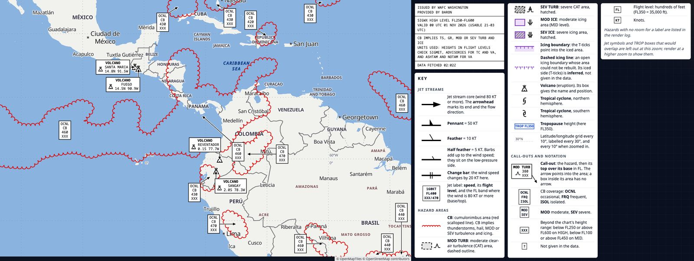
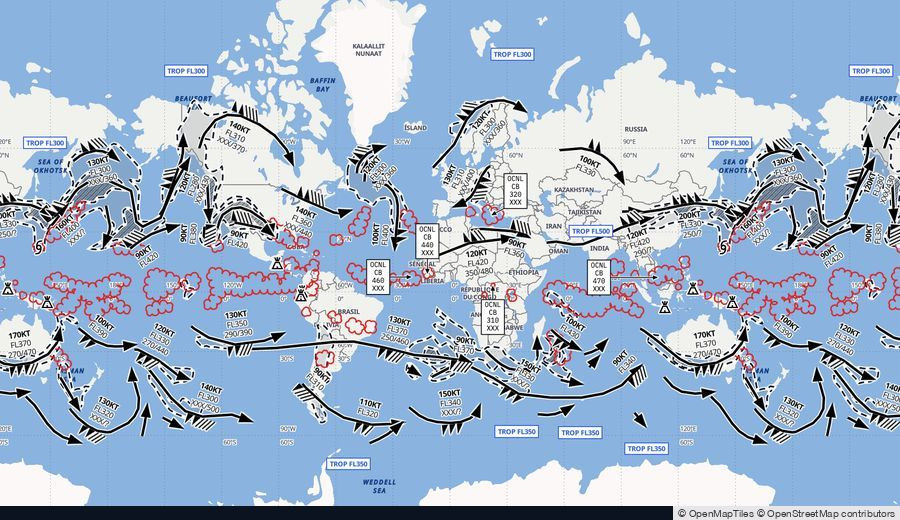
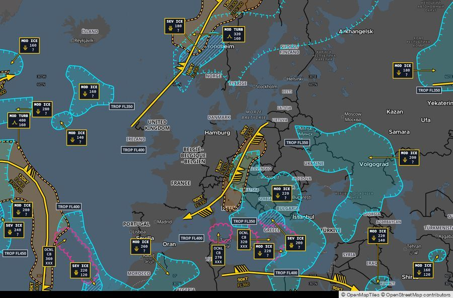
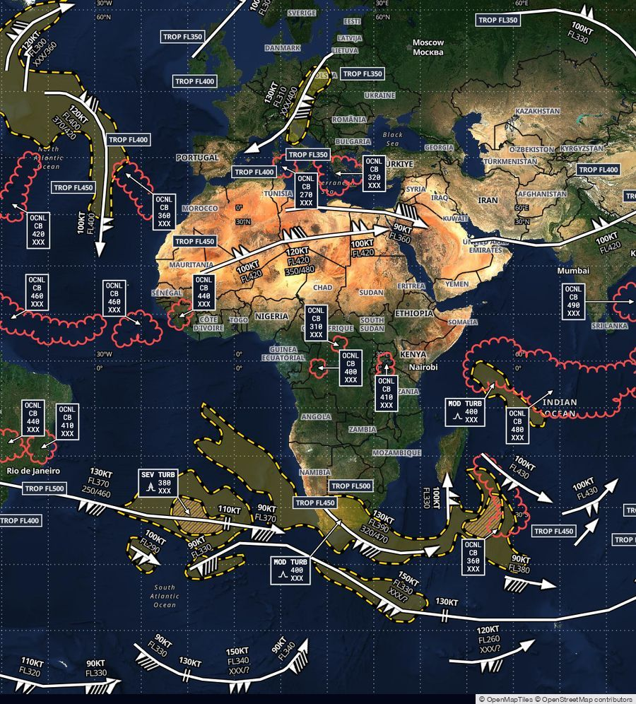
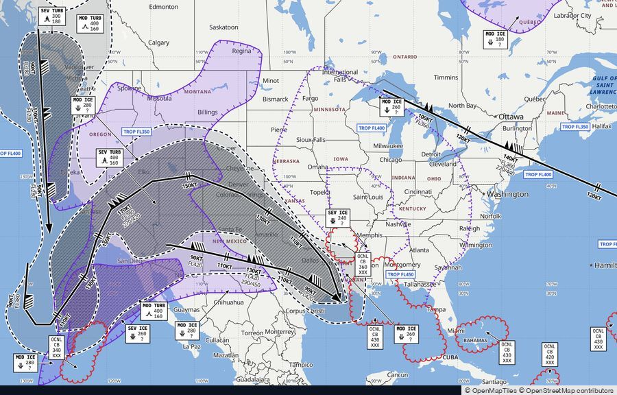
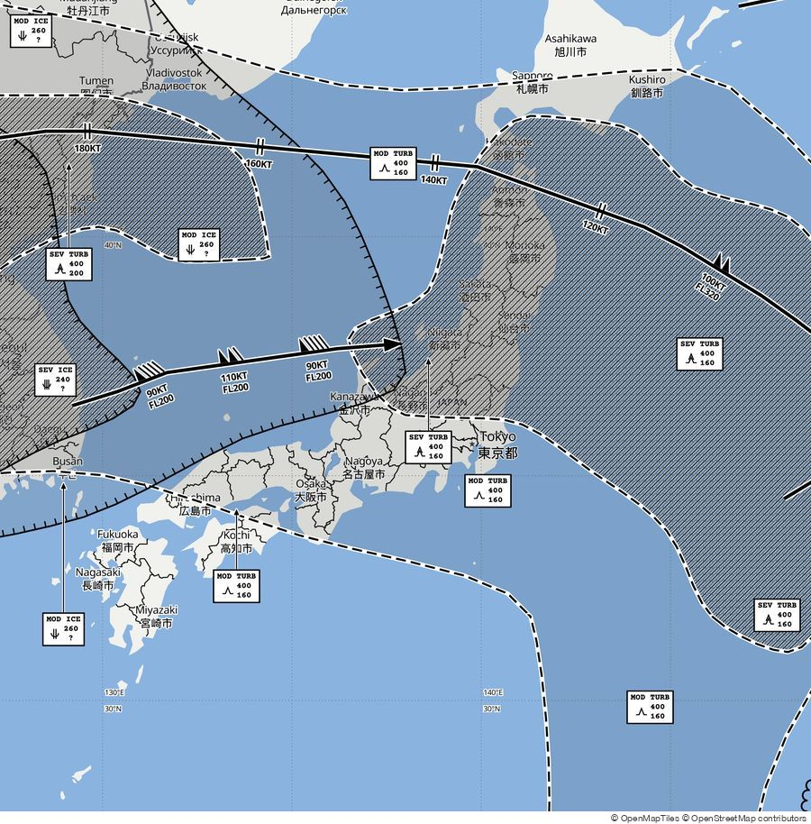
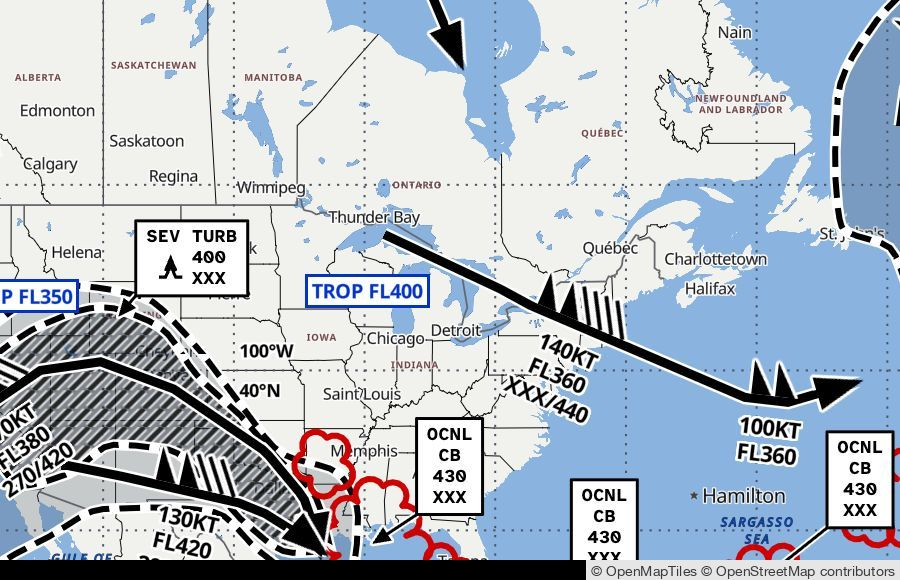

# SIGWX charts

Draws Baron's SIGWX (significant weather) feeds as WAFC-style aviation charts on Baron basemaps, in two ways:

- **Chart images.** A command-line tool turns a small JSON "job" file into a PNG chart, with an optional legend and KEY beside the map. You choose the feed, the time, the area, the layers and, if you like, the colours, line widths and fonts.
- **An interactive chart.** A local web page you can pan, zoom and click, with the same symbols and labels.

It covers four feeds:

| Product | Level | Range | Issued by |
|---|---|---|---|
| `sigwx` | high | FL250–FL600 | WAFC Washington |
| `sigwx` | mid | FL100–FL450 | WAFC Washington |
| `sigwx_alt` | high | FL250–FL600 | WAFC London |
| `sigwx_alt` | mid | FL100–FL450 | WAFC London |

It draws jet streams (with barbs and change bars), CB areas, clear-air turbulence, icing (mid level), tropopause heights, volcanoes and tropical cyclones. The chart follows the ICAO "Guidelines for interpreting WAFC T+24 SIGWX" (V2.01). Every symbol is explained in the KEY, labels never overlap, and a hazard label that cannot be placed is listed rather than dropped.

It is a small Node.js program with **no packages to install**.

## What it makes

The default chart, with its legend and KEY (`examples/area-a.json`):



Every colour, line, font and size can be changed in the job file. A few of the ready-made examples (map area only, rendered from the live feeds on 1 November 2026):

| | |
|---|---|
|  **The whole world**, high level, briefing style (`examples/regions/global-world-high.json`) |  **Europe at night**, mid level, dark style (`examples/regions/continent-europe.json`) |
|  **Africa on satellite imagery** (`examples/regions/continent-africa.json`) |  **The United States at mid level**, with icing (`examples/regions/country-usa.json`) |
|  **Japan for print**, black and white at 2× (`examples/regions/country-japan.json`) |  **Large print** for low vision, detail at full size (`examples/big/continent-north-america.json`) |

---

## Contents

- [What it makes](#what-it-makes)
- [Quick start](#quick-start)
- [Requirements](#requirements)
- [Setup](#setup)
- [Making chart images](#making-chart-images)
  - [Listing valid times](#listing-valid-times)
  - [Writing a job file](#writing-a-job-file)
  - [Choosing the area](#choosing-the-area)
  - [Examples](#examples)
  - [What it prints](#what-it-prints)
  - [Errors and exit codes](#errors-and-exit-codes)
  - [Automating](#automating)
- [Styling a chart](#styling-a-chart)
  - [Common changes](#common-changes)
  - [Every style key](#every-style-key)
- [The interactive chart](#the-interactive-chart)
- [Reading the chart](#reading-the-chart)
- [Troubleshooting](#troubleshooting)
- [Known limitations](#known-limitations)
- [Publishing and support](#publishing-and-support)
- [Security](#security)
- [For developers and maintainers](#for-developers-and-maintainers)

---

## Quick start

From a fresh copy of the folder to your first chart image.

**Before you start**, you need:
- **Node.js 22.4 or later.** If `node --version` fails or shows an older version, install the current release from [nodejs.org](https://nodejs.org), then open a new terminal.
- **Google Chrome** ([google.com/chrome](https://www.google.com/chrome/)).
- **Both a Baron access key and its matching secret**, with access to the SIGWX reports. If you have only one of them, ask the Baron contact who supplied it for the other.
- **A terminal** open in the `sigwx-client` folder. The commands here are for macOS or Linux (bash or zsh).

1. **Check Node.js** (22.4 or later):

   ```
   node --version
   ```

2. **Check that Google Chrome is installed.** The tool drives it in the background; no window opens.

   ```
   ls "/Applications/Google Chrome.app"          # macOS
   which google-chrome chromium chromium-browser  # Linux: at least one should print a path
   ```

   If Chrome is somewhere else, see `CHROME_PATH` under [Requirements](#requirements). Step 5 is the real test.

3. **Add your Baron credentials.** Copy the example file to `.env` in the `sigwx-client` folder:

   ```
   cp env.example .env
   ```

   Then open `.env` in a text editor and replace the two placeholders with your key and secret:

   ```
   BARON_ACCESS_KEY=your_access_key
   BARON_ACCESS_KEY_SECRET=your_access_secret
   ```

4. **Check that the feeds answer.** This lists the valid times of all four feeds:

   ```
   node cli/sigwx.js times
   ```

   If you see four lists of times, your credentials work. If you see an error, see [Troubleshooting](#troubleshooting).

5. **Render your first chart:**

   ```
   node cli/sigwx.js render examples/area-a.json
   ```

   It prints `wrote …/area-a.png` and writes the image into the folder you ran it from.

6. **Make it your own.** Copy an example, then edit the copy: set `output` to a new file name (otherwise it writes `area-a.png` again, replacing the image from step 5), and change `center` and `zoom` to frame your area ([Choosing the area](#choosing-the-area)):

   ```
   cp examples/area-a.json my-chart.json
   # edit my-chart.json: "output": "my-chart.png", "center": { "lat": 36, "lon": 138 }, "zoom": 4
   node cli/sigwx.js render my-chart.json
   ```

7. **Change the look** with a `style`. Render a styled example, then copy one into your own job or see [Styling a chart](#styling-a-chart):

   ```
   node cli/sigwx.js render examples/style-baron-brand.json
   ```

8. **Open the interactive chart** (optional): `npm start`, then browse to **http://localhost:8787**. Stop it with Ctrl-C.

## Requirements

- **Node.js 22.4 or later.** Developed and tested on Node 26.8.1; older versions in the allowed range have not been tested. Check with `node --version`.
- **A Baron Weather API access key and secret** with access to the `sigwx` and `sigwx_alt` reports. If you don't have them, ask Baron for API access to the SIGWX reports. The tool also signs its basemap requests with them; if Baron refuses those, the basemap comes out blank and the CLI says so.
- **Google Chrome**, for chart images only. The tool looks for it in this order:
  1. the path in `CHROME_PATH`, if set (in the shell or in `.env`), and nowhere else;
  2. `/Applications/Google Chrome.app` or `/Applications/Chromium.app` (macOS);
  3. `google-chrome`, `chromium` or `chromium-browser` on your `PATH` (Linux).
- **Internet access** from the machine. The chart loads:
  - the SIGWX feeds from `api.velocityweather.com` (through the tool, with your key);
  - the basemap styles, tiles and map fonts from `cdnmaps.velocityweather.com` (through the tool, signed with your key);
  - the MapLibre GL JS 4.7.1 map library from `cdn.jsdelivr.net`;
  - the text fonts from Google Fonts (`fonts.googleapis.com`, `fonts.gstatic.com`).
- **Platform.** Developed and tested on macOS. On Linux, Chrome is found on the `PATH`, but this has been unit-tested only, not run. Windows has not been tested; `scripts/render-examples.sh` needs a bash shell.

## Setup

1. Get the `sigwx-client` folder onto your machine. There is nothing to install: `npm install` is not needed.

2. Copy `env.example` to `.env` in that folder (`cp env.example .env`) and put your credentials in it:

   ```
   BARON_ACCESS_KEY=your_access_key
   BARON_ACCESS_KEY_SECRET=your_access_secret
   ```

   - Keep this file private (`chmod 600 .env` on macOS and Linux) and never commit it. The folder's `.gitignore` excludes it; if you copy the folder into another repository, make sure that one excludes `.env` too.
   - To keep the file somewhere else, point `SIGWX_ENV_FILE` at it, e.g. `SIGWX_ENV_FILE=/path/to/sigwx.env node cli/sigwx.js times`.
   - Variables already set in your shell take precedence over the file.
   - `CHROME_PATH` and `PORT` can go in the same file.

3. Check the setup with `node cli/sigwx.js times` (see [Listing valid times](#listing-valid-times)).

## Making chart images

The `sigwx` command lists the valid times and renders one PNG per job file:

```
node cli/sigwx.js times [--product sigwx|sigwx_alt] [--level high|mid]
node cli/sigwx.js render <job.json>
node cli/sigwx.js --help
```

It needs no running server: it starts its own copy on a free port, reads the same `.env`, drives Chrome in the background, and shuts everything down when it finishes. A render takes a few seconds.

You can run it from any folder by giving the full path to `cli/sigwx.js`; the job path, and the job's `output`, are relative to the folder you run it from:

```
node /path/to/sigwx-client/cli/sigwx.js render job.json
```

Other ways to call it:
- `npm run sigwx -- render job.json`. npm runs it from the `sigwx-client` folder, so paths are relative to that folder, not to where you typed the command.
- `sigwx render job.json`, after running `npm link` once in the `sigwx-client` folder.

### Listing valid times

```
$ node cli/sigwx.js times --product sigwx --level high
SIGWX HIGH (sigwx high)
2026-10-30T06:00:00Z  06Z 30 OCT  usable 03–09 UTC
2026-10-30T12:00:00Z  12Z 30 OCT  usable 09–15 UTC
2026-10-30T18:00:00Z  18Z 30 OCT  usable 15–21 UTC  ← current
2026-10-31T00:00:00Z  00Z 31 OCT  usable 21–03 UTC
2026-10-31T06:00:00Z  06Z 31 OCT  usable 03–09 UTC
```

Each line gives the ISO time (the value a job's `valid` takes), a short label, and the usable window: the period the chart is meant to be used for, from 3 hours before the valid time to 3 hours after. All times are UTC (`Z`); a window such as `21–03` runs over midnight UTC. Valid times are 6 hours apart, and a feed holds about a day of them. `← current` marks the time a job with `"valid": "current"` picks, by your computer's clock: the one whose usable window contains the time now, or the nearest one.

Without options, all four feeds are listed. If a feed fails, its line reads `<FEED>: <error>`, the others are still listed, and the exit code is 1.

### Writing a job file

One JSON file makes one image. Only `output` is required; everything else has a default. This job sets every top-level key, to its default except `output` and `key`:

```json
{
  "output": "charts/area-a.png",
  "product": "sigwx",
  "level": "high",
  "valid": "current",
  "center": { "lat": 5, "lon": -80 },
  "zoom": 3.75,
  "basemap": "light",
  "density": 1.0,
  "layers": { "all": true },
  "legend": true,
  "key": true,
  "width": 1280,
  "height": 800,
  "scale": 1
}
```

| Key | Values | Default |
|---|---|---|
| `output` | path ending in `.png`, relative to the current folder; missing folders are created | **required** |
| `product` | `sigwx`, `sigwx_alt` | `sigwx` |
| `level` | `high`, `mid` (icing is on the mid level only) | `high` |
| `valid` | `"current"`, or an ISO time with a zone from `sigwx times`; matched by instant | `"current"` |
| `center` | `{ "lat": -85…85, "lon": -180…180 }` | `{ "lat": 5, "lon": -80 }` |
| `zoom` | 0 – 14 (fractions allowed); see [Choosing the area](#choosing-the-area) | `3.75` |
| `basemap` | `light`, `dark`, `satellite` | `light` |
| `density` | 0.5 – 2.0: how tightly hazard labels may be packed. Higher fits more labels; labels never overlap at any setting | `1.0` |
| `layers` | see below | all on |
| `legend` | `true` / `false`: the legend block beside the map | `true` |
| `key` | `true` / `false`: the KEY beside the map | `false` |
| `width`, `height` | map size in CSS px, whole numbers 200 – 4096; `width × scale` and `height × scale` may each be at most 8192 | `1280`, `800` |
| `scale` | pixel ratio 1 – 3; `2` doubles the file's pixel size, for print or high-DPI screens | `1` |
| `style` | colours, line widths, fonts and sizes; see [Styling a chart](#styling-a-chart) | the standard look |

Any unknown key or bad value is an error, and every problem in the file is listed at once.

**Layers.** The keys are `all`, `jets`, `cb`, `turbulence`, `icing`, `tropopause`, `volcanoes`, `cyclones` and `grid`. `all` is applied first, then the named keys override it:

| `layers` | Shows |
|---|---|
| `{ "all": true }` or omitted | everything |
| `{ "all": false }` | the basemap only |
| `{ "all": false, "jets": true }` | jet streams only |
| `{ "tropopause": false, "grid": false }` | everything except tropopause boxes and the grid |

**The image.** It is drawn by the same code as the interactive chart, with the same labels, call-outs and no-overlap rules. Its parts are:
- the map, always exactly `width` × `height`, so `center` and `zoom` frame the same area whatever else is added;
- a thin attribution strip directly below the map (© OpenMapTiles © OpenStreetMap contributors), 14 px tall by default, which covers nothing. Keep it in any image you publish;
- the legend and the KEY, when requested, in columns to the right of the map. The KEY flows into extra columns to keep the image's height. The panel column is at least 360 px tall, so for a `height` under 360 the image is taller than the map.

So a 1280×800 job with a legend and KEY makes an image about 2161×814 px; the same job at `scale: 2` makes one twice that in each direction.

### Choosing the area

`center` is the middle of the map. `zoom` sets how much of the world shows: each step of 1 halves the span. A map `width` px wide shows `width × 360 / (512 × 2^zoom)` degrees of longitude. Measured for a 1280 × 800 map:

| `zoom` | Longitude shown | Latitude shown (centred on 40°N) | Good for |
|---|---|---|---|
| 2 | 225° | 26°S – 74°N | an ocean basin and its coasts |
| 3 | 112° | 9°N – 62°N | a continent, e.g. the North Atlantic |
| 3.75 (default) | 67° | 22°N – 54°N | a large region, e.g. Europe or the continental US |
| 4 | 56° | 25°N – 52°N | a large region |
| 5 | 28° | 33°N – 46°N | a country or a few US states |
| 6 | 14° | 37°N – 43°N | a smaller region |

A wider map shows proportionally more longitude at the same zoom. Latitude shown shrinks towards the poles, as on any Mercator map. To find a centre, any map site that shows coordinates will do; west longitudes and south latitudes are negative.

The map ends at 85.05°N and 85.05°S, so two jobs are drawn differently from what they ask, and the CLI warns about each:
- a map taller than the whole world at its zoom (taller than 512 × 2^`zoom` px, e.g. 800 px at zoom 0.5) is drawn at the zoom that fills it, centred on the equator;
- a centre so near a pole that the view would reach past 85.05° is moved towards the equator until it does not.

Very wide views (zoom below about 3) are crowded: more hazard labels will not fit, and are listed instead (see [What it prints](#what-it-prints)). Zoom in, raise `density`, or switch layers off to place them.

### Examples

Ready-made jobs are in `examples/`. Each uses the current time and writes its PNG, named after the job, into the folder you run it from:

| Job | What it shows | Panels |
|---|---|---|
| `area-a.json` | The Area A view (Central and South America), all layers, Light basemap | legend, KEY |
| `pacific-jets-only.json` | The South Pacific, jets only, Dark basemap | legend, KEY |
| `north-atlantic-mid.json` | The **mid** level (FL100–FL450) over the North Atlantic, with icing, Satellite basemap | legend, KEY |
| `conus-turbulence.json` | Turbulence and the grid only, over the continental US | legend |
| `europe-alt-dark.json` | **`sigwx_alt`** (WAFC London) over Europe, Dark basemap, density 1.5 | legend, KEY |
| `asia-hazards-only.json` | Southeast Asia with every layer except jets and tropopause | legend, KEY |
| `south-america-print.json` | South America, portrait 1200×1500 at scale 2 (a file about 2400×3000 px) | none |
| `large-print.json` | The North Atlantic at 1600×1000 with a `style`: thicker lines, larger text, a white panel | legend, KEY |
| `style-baron-brand.json` | The western Atlantic in Baron brand colours (Baron Red CB, navy and blue hazards, `#eaf0f4` panel) with Roboto and Roboto Mono | legend, KEY |
| `style-print-mono.json` | **`sigwx_alt`** over Europe, every SIGWX mark in black ink, at scale 2 for printing | legend, KEY |
| `style-night-ops.json` | The **mid** level over the North Atlantic on the Dark basemap: yellow jets, cyan icing, orange turbulence, a dark legend and KEY, IBM Plex fonts | legend, KEY |
| `style-colorblind.json` | The **mid** level over Southeast Asia in the Okabe–Ito colour-blind-safe palette | legend, KEY |
| `style-minimal.json` | The South Pacific with thin lines, no casings, small call-outs, a 15° grid and density 0.75 | none |
| `style-satellite-bold.json` | Africa to India on the Satellite basemap: white jets and turbulence outlines with black casings, red CB outlines, Metropolis Bold for the bold map labels | legend, KEY |
| `style-us-detail.json` | The central US at zoom 5.2 with roads and state borders shown, a 5° grid and CB call-outs placed first | legend |

`examples/map-only/` holds the first six jobs again with no legend and no KEY. Each writes `<name>-map.png`, so it does not overwrite the version with panels. `map-only/asia-hazards-only.json` renders at 4K: `width` 1920, `height` 1066 and `scale` 2 give exactly 3840×2160 px, because the 14 px attribution strip is part of the image.

`examples/regions/` holds 39 more jobs, from the whole world down to single airports: 4 global views (`global-*`), 11 continents and ocean regions (`continent-*`), 15 countries (`country-*`) and 9 close-ups at zoom 9–10.5 (`close-*`). Each one sets every job key and all 117 style keys, so each is a complete template: copy the one closest to what you need and change any value. They use seven high-contrast themes: briefing (light basemap), night operations (dark), satellite, print (black and white), colour-blind safe (the Okabe-Ito palette), wall display (large type) and dispatch (condensed type). The grid, label density and basemap detail follow the scale: country views show state borders, and close-ups add roads, road labels and points of interest. Each writes `<name>.png`.

`examples/big/` holds 20 continental and regional jobs for people who need large print: 8 continents and oceans (`continent-*`) and 12 regions (`region-*`). They also set every key, with call-out text at 18 px, jet labels at 22 px, the legend and KEY at 16 px, lines two to three times the default width, the largest arrowheads, volcano and cyclone symbols nearly twice the default size, and fonts made for low vision (Atkinson Hyperlegible). A lower label density gives the big labels room, so continent-wide views list more hazards as having no room for a label; the regional views fit nearly all. They come in three palettes: high-contrast light, dark (yellow, cyan and magenta on black) and colour-blind safe. Each writes `<name>-big.png`.

To render every example back to back (needs bash):

```
scripts/render-examples.sh [output-folder]
```

The output folder defaults to the current folder. A failed job is reported and the rest still run; the exit code is 1 if any failed. Ctrl-C stops the whole run.

### What it prints

```
$ node cli/sigwx.js render examples/area-a.json
wrote /…/area-a.png (2161×814 px)
SIGWX HIGH, valid 2026-10-30T18:00:00Z (18Z 30 OCT), usable 15–21 UTC
17 hazard labels placed
1 hazard with no room for a label:
  OCNL CB 490 XXX near 9.9N 41.9W [cb-3]
```

The lines are: the file written and its size; the feed, valid time and usable window; how many hazard labels were placed; and the hazards whose label found no room. At `scale` 2 or 3 the first line also gives the size in CSS px, e.g. `wrote /…/asia-hazards-only-map.png (3840×2160 px, 1920×1080 CSS px at scale 2)`. These lines and the warnings below go to standard output; errors, and the temporary-profile warning, go to standard error. An image cannot be clicked, so those hazards are listed here, once each, with their values, position and feature id. Zoom in, raise `density` or switch layers off to place them. A listed hazard is not an error.

The CLI also prints a `warning:` line (the image is still written, and the exit code is still 0) when:
- the chosen time is outside its usable window;
- the map was still loading after 20 s, so the basemap may be incomplete. Re-run it. When the right-to-left text plugin had not loaded, the warning says so: MapLibre draws nothing until it has, so the map is blank, SIGWX lines and areas included;
- Baron's map CDN did not serve some or all of the basemap tiles for the view. The warning says whether the basemap is blank or partly missing, and how many tiles were not served;
- the map was drawn at another zoom or centre than the job asks (see [Choosing the area](#choosing-the-area));
- the image has no basemap attribution strip. It must not be published without one;
- Chrome's temporary profile could not be removed (harmless; the folder is named in the message).

### Errors and exit codes

| Exit | When |
|---|---|
| 0 | the image was written; unlabelled hazards are listed but are not an error |
| 1 | any error, with a plain message (one line per problem); no image is written, and an existing file at `output` is left untouched |
| 130 | interrupted with Ctrl-C (prints `interrupted`) |
| 143, 129 | stopped by `SIGTERM` or `SIGHUP` (prints `stopped by SIGTERM` or `stopped by SIGHUP`) |

When the CLI is stopped, Chrome and its temporary profile are cleaned up first. For the error messages and their fixes, see [Troubleshooting](#troubleshooting).

### Automating

Each render is a single command with a clear exit code, so it fits in scripts and schedulers. What the exit code means:
- **0**: a PNG was written. Read the printed lines too: a `warning:` (a blank or incomplete basemap, a moved map, a time outside its usable window, no attribution strip) still exits 0.
- **1**: nothing was written; the message says why. The PNG at `output` is only ever replaced by a complete image, never left half-written.

With `"valid": "current"`, a job draws the step whose usable window contains the time it runs, or the nearest one if none does. To render a particular time instead, put its ISO time from `sigwx times` in `valid`; a time no longer in the feed is an error, never silently replaced.

This script template keeps a history: it renders one job and copies the image to a name with the time it was made. Replace the two paths, keep the job file in the work folder, and run it from anywhere:

```bash
#!/usr/bin/env bash
# Renders jobs/atlantic.json and keeps a copy named after the time it was made.
set -euo pipefail
WORK=/path/to/chart-work-folder              # holds jobs/; charts/ is written here
SIGWX=/path/to/sigwx-client/cli/sigwx.js
cd "$WORK"
node "$SIGWX" render jobs/atlantic.json
cp charts/atlantic.png "charts/atlantic-$(date -u +%Y%m%dT%H%M%SZ).png"
```

With `jobs/atlantic.json` in the work folder:

```json
{ "output": "charts/atlantic.png", "center": { "lat": 40, "lon": -40 }, "zoom": 3.5, "key": true }
```

The copy is named to the second, so a re-run in the same second replaces it. When a scheduler such as cron runs the script, give the full path to `node` (find it with `command -v node`) and set `SIGWX_ENV_FILE`, unless `.env` is in the `sigwx-client` folder; schedulers start with a minimal environment. Keep the script's output (cron can mail it or you can redirect it to a log) so warnings are seen.

Each render fetches its feed from Baron afresh: separate commands do not share a cache. Schedule renders at a pace your Baron account allows; feeds have new valid times every 6 hours.

## Styling a chart

`style` changes how the chart looks, not what it shows. Every key is optional; anything left out keeps the standard look, and a job with no `style` (or `"style": {}`) draws the standard chart. Keys nest one name per level: `"jets": { "line": { "width": 6 } }`, never `"jets.line.width"`.

```json
{
  "output": "styled.png",
  "style": {
    "jets": { "line": { "color": "#1d1d1d", "width": 5 }, "label": { "size": 15 } },
    "cb": { "color": "#c00000" },
    "callouts": { "size": 13, "borderWidth": 2 },
    "fonts": { "labels": "Roboto Mono", "text": "Lato" },
    "panel": { "background": "#ffffff" }
  }
}
```

A bad value fails the render with every problem listed, each by its full path (`"style.jets.line.width" must be a number from 1 to 12`). The interactive chart accepts the same object as `?style=<URL-encoded JSON>`; there a bad one shows in a red banner and the standard look is used.

**Values.** Colours are `#rgb` or `#rrggbb`. Opacities are 0 – 1. Sizes and widths are CSS px (multiplied by `scale` in the file). A dash is a list of 2 – 8 numbers from 0 to 20 (dash, gap, …), in units of the line's width, every dash above 0; `[1, 0]` is solid. A `weight` is `"regular"` or `"bold"`. A width that may be 0 draws nothing at 0.

**Fonts.** Two kinds of text use two kinds of font:
- Map labels (jet labels, TROP boxes, grid labels) come from the basemap's font server, which has five fonts: `fonts.mapRegular` and `fonts.mapBold` are each one of `"Noto Sans Regular"`, `"Noto Sans Bold"`, `"Noto Sans Italic"`, `"Metropolis Bold"`, `"Metropolis Semi Bold"`.
- Call-outs, the legend and the KEY use web fonts: `fonts.labels` (call-outs, legend, KEY chips) and `fonts.text` (the KEY's text) take a [Google Fonts](https://fonts.google.com) family name, spelled as Google spells it (`"IBM Plex Mono"`, `"Roboto"`), which must have weights 400 and 700.

A web font that does not load within 20 s, or loads without both weights, fails the render, so an image's call-outs, legend and KEY never silently use another font; the interactive chart instead shows a red banner and falls back. A map font that the font server refuses also fails the render. (A map font that is merely slow is covered by the 20 s map-loading warning instead.) The KEY draws its text with the web fonts, so a map font does not show in it.

### Common changes

Each of these is a complete `style`; combine them freely. The `style-*.json` examples are fuller versions.

**Larger text and thicker lines, for print or a wall screen** (`large-print.json`):

```json
"style": {
  "jets": { "line": { "width": 5 }, "label": { "size": 16 } },
  "tropopause": { "size": 14 },
  "grid": { "label": { "size": 13 } },
  "callouts": { "size": 14, "symbolSize": 24, "borderWidth": 2 },
  "legend": { "size": 13 },
  "key": { "size": 14, "headingSize": 13, "chipSize": 12 }
}
```

**Your organisation's colours** (`style-baron-brand.json`): set the hazard colours and the panel to match:

```json
"style": {
  "cb": { "color": "#da1a32" },
  "jets": { "line": { "color": "#002f7a" }, "label": { "color": "#002f7a" } },
  "turbulence": { "moderate": { "fill": "#0072bc", "opacity": 0.15 }, "severe": { "fill": "#002f7a", "opacity": 0.3 } },
  "panel": { "background": "#eaf0f4" }
}
```

**Black and white for printing** (`style-print-mono.json`): all SIGWX marks in black, with fills told apart by depth and the hatch:

```json
"style": {
  "turbulence": { "moderate": { "fill": "#000", "opacity": 0.07 }, "severe": { "fill": "#000", "opacity": 0.18 } },
  "icing": { "moderate": { "fill": "#000", "opacity": 0.07 }, "severe": { "fill": "#000", "opacity": 0.18 }, "line": { "color": "#000" } },
  "cb": { "color": "#000" },
  "tropopause": { "color": "#000", "border": "#000" },
  "panel": { "background": "#ffffff" }
}
```

**A dark chart** (`style-night-ops.json`): use `"basemap": "dark"` in the job, then light ink on dark boxes:

```json
"style": {
  "symbols": { "color": "#ffd400", "halo": "#000" },
  "jets": { "line": { "color": "#ffd400" }, "casing": { "color": "#000" }, "label": { "color": "#ffd400", "halo": "#000" } },
  "callouts": { "fill": "#111827", "color": "#f3f4f6", "border": "#ffd400", "leader": { "color": "#ffd400", "casing": "#000" } },
  "legend": { "background": "#111827", "color": "#f3f4f6", "border": "#ffd400" },
  "key": { "background": "#111827", "color": "#f3f4f6", "headingColor": "#ffd400", "noteColor": "#9ca3af", "ruleColor": "#374151" },
  "panel": { "background": "#000000" }
}
```

**Colour-blind-safe hazards** (`style-colorblind.json`), from the Okabe–Ito palette:

```json
"style": {
  "turbulence": { "moderate": { "fill": "#e69f00", "opacity": 0.25 }, "severe": { "fill": "#d55e00", "opacity": 0.35 } },
  "icing": { "moderate": { "fill": "#56b4e9", "opacity": 0.25 }, "severe": { "fill": "#0072b2", "opacity": 0.35 }, "line": { "color": "#0072b2" } },
  "cb": { "color": "#cc79a7" },
  "tropopause": { "color": "#009e73", "border": "#009e73" }
}
```

**Different fonts:**

```json
"style": { "fonts": { "labels": "IBM Plex Mono", "text": "IBM Plex Sans", "mapBold": "Metropolis Bold" } }
```

**A white strip and panel around a map-only image** (the strip under the map is dark by default): `"style": { "panel": { "background": "#ffffff" } }`.

**More basemap detail**, for a zoomed-in view (`style-us-detail.json`): `"style": { "basemap": { "roads": true, "roadLabels": true, "stateBorders": true } }`.

### Every style key

| Key | Default | Allowed |
|---|---|---|
| `fonts.mapRegular`, `fonts.mapBold` | `"Noto Sans Regular"`, `"Noto Sans Bold"` | the five map fonts above |
| `fonts.labels`, `fonts.text` | `"Noto Sans Mono"`, `"Noto Sans"` | a Google Fonts family: letters and digits, single spaces between words, at most 40 characters |
| `symbols.color`, `.halo` | `"#000"`, `"#fff"` | ink and outline of every icon, barb, change bar and arrow (map, call-outs, KEY) |
| `symbols.haloWidth` | `1.5` | 0 – 4 (map symbols; the KEY's barb swatches show it too) |
| `symbols.stroke` | `0.085` | 0.05 – 0.12: line width as a fraction of the icon's size |
| `jets.line.color`, `.width` | `"#000"`, `4` | 1 – 12 |
| `jets.casing.color`, `.width` | `"#fff"`, `7` | 0 – 20: the outline under the jet line |
| `jets.label.size`, `.color`, `.halo`, `.haloWidth` | `13`, `"#000"`, `"#fff"`, `1.5` | 8 – 24; haloWidth 0 – 4 |
| `jets.label.speedWeight`, `.weight` | `"bold"`, `"regular"` | the speed line; the FL and depth lines |
| `jets.barbs.scale`, `.width` | `1`, `2` | 0.5 – 2 (a pennant is 10×17 px at 1); 0.5 – 5 |
| `jets.arrowSize`, `jets.changeBarSize` | `24`, `24` | 12 – 48 |
| `turbulence.moderate.fill`, `.opacity` | `"#808080"`, `0.2` | |
| `turbulence.severe.fill`, `.opacity` | `"#4a4a4a"`, `0.35` | |
| `turbulence.outline.color`, `.width`, `.dash` | `"#000"`, `2.5`, `[3, 2]` | width 0.5 – 10 |
| `turbulence.casing.color`, `.width` | `"#fff"`, `5.5` | 0 – 20 |
| `icing.moderate.fill`, `.opacity` | `"#9d4edd"`, `0.18` | (icing is drawn on MID charts only) |
| `icing.severe.fill`, `.opacity` | `"#5a189a"`, `0.35` | |
| `icing.line.color`, `.width`, `.fallbackDash` | `"#7b2cbf"`, `2`, `[2, 1.5]` | width 0.5 – 10; the dash marks an open boundary whose iced side is inferred |
| `icing.ticks.width`, `.length`, `.spacing` | `1.5`, `7`, `18` | 0.5 – 6; 2 – 20; 6 – 60 (the KEY keeps its own spacing) |
| `hatch.opacity`, `.size` | `0.6`, `8` | the severe hatch over severe turbulence and icing; size a whole number 4 – 32 |
| `hatch.color`, `.width`, `.edge`, `.edgeWidth` | `"#000"`, `1.5`, `"#fff"`, `3.5` | width 0.5 – size/2; edgeWidth 0 – size/2 |
| `cb.color`, `.width`, `.scallop` | `"#e00000"`, `2`, `14` | width 0.5 – 10; scallop 6 – 40 px between scallop ends |
| `tropopause.color`, `.border`, `.fill` | `"#1d4ed8"`, `"#1d4ed8"`, `"#fff"` | text, box border, box fill |
| `tropopause.borderWidth`, `.size`, `.weight` | `1.5`, `11`, `"bold"` | 0 – 4; 8 – 24 |
| `volcanoes.size`, `cyclones.size` | `24`, `24` | 12 – 48 (the KEY keeps its own size) |
| `grid.color`, `.width`, `.dash` | `"#8b929c"`, `1`, `[1, 4]` | width 0.5 – 4 |
| `grid.spacing`, `.labelEvery` | `10`, `30` | spacing 5, 10, 15, 20 or 30°; labelEvery a multiple of it, up to 90°. Labels shown at every zoom are those within ±60° |
| `grid.allLabelsFromZoom` | `5` | 0 – 24: from this zoom every line is labelled (above 14, never in a job) |
| `grid.label.size`, `.color`, `.halo`, `.haloWidth`, `.weight` | `11`, `"#374151"`, `"#fff"`, `1.5`, `"regular"` | 8 – 24; haloWidth 0 – 4 |
| `callouts.size` | `11` | 8 – 20 (the line height follows) |
| `callouts.color`, `.fill`, `.border`, `.borderWidth` | `"#000"`, `"#fff"`, `"#000"`, `1.5` | text, box, border; borderWidth 0 – 4 |
| `callouts.weight`, `.headerWeight` | `"regular"`, `"bold"` | |
| `callouts.paddingX`, `.paddingY`, `.symbolSize`, `.symbolGap` | `5`, `3`, `18`, `4` | 2 – 12; 1 – 10; 10 – 28; 0 – 12 |
| `callouts.leader.color`, `.width`, `.casing`, `.casingWidth` | `"#000"`, `1.5`, `"#fff"`, `4` | width 0.5 – 4; casingWidth 0 – 10 |
| `callouts.leader.arrowLength`, `.arrowWidth` | `9`, `8` | 4 – 20 each |
| `callouts.priority` | `["severeTurbulence", "severeIcing", "volcanoes", "cyclones", "cb", "moderateTurbulence", "moderateIcing"]` | the same seven names in any order, placed first to last |
| `callouts.repeats.max`, `.spacing`, `.minClearance` | `3`, `400`, `24` | extra boxes on a large area: whole number 0 – 10; 100 – 2000 px apart; 8 – 200 px from its edges |
| `callouts.edgePieces` | `true` | `false`: an area cut by the image edge gets one call-out at its own anchor |
| `legend.size`, `.lineHeight`, `.paddingX`, `.paddingY` | `10.5`, `1.4`, `8`, `5` | 8 – 16; 1 – 2; 0 – 20; 0 – 20 |
| `legend.color`, `.background`, `.border`, `.borderWidth` | `"#000"`, `"#fff"`, `"#000"`, `1.5` | borderWidth 0 – 4 |
| `key.size`, `.headingSize`, `.chipSize` | `12`, `11`, `10.5` | 9 – 16; 8 – 16; 8 – 16 |
| `key.color`, `.background`, `.headingColor`, `.noteColor`, `.ruleColor` | `"#0b1220"`, `"#fff"`, `"#4b5563"`, `"#374151"`, `"#eef0f4"` | text, background, headings, the notes at its foot, the rules between rows |
| `panel.background` | `null` | `null`: the dark panel; a colour: a flat panel and strip of that colour |
| `panel.columnWidth`, `.columnGap`, `.padding` | `280`, `10`, `10` | 240 – 480; 0 – 40; 0 – 40 (the image's panel columns; the interactive chart's side panel keeps its own) |
| `attribution.size` | `10` | 8 – 14 (the image's attribution strip; the interactive chart keeps its own) |
| `basemap.roads`, `.roadLabels`, `.buildings`, `.pointsOfInterest`, `.stateBorders` | all `false` | `true` shows that basemap group. Road labels appear from zoom 7, points of interest from zoom 10 (Light) or 13 (Dark, Satellite), and buildings only far in (they show at zoom 14); the Satellite basemap has no buildings |

**Rules between keys:**
- the jet arrowhead must cover the line's end: `(jets.line.width + 0.2) / 0.7 ≤ jets.arrowSize`;
- a change bar must reach 2 px past the line: `0.42 × jets.changeBarSize ≥ jets.line.width / 2 + 2`;
- feathers must stay apart: `jets.barbs.width + 1 ≤ 5.17 × jets.barbs.scale`;
- `grid.labelEvery` must be a multiple of `grid.spacing`;
- `hatch.width` and `hatch.edgeWidth` at most half of `hatch.size`.

**Some keys change more than looks:**
- `callouts.priority` decides which hazard gets room first. By default severe hazards come first; putting moderate ones first can leave a severe hazard without a box.
- `callouts.edgePieces: false` and `callouts.repeats` change how many boxes a large or cut area gets.
- `basemap.stateBorders: true` brings back state and province borders, which are hidden by default because they can be taken for SIGWX boundaries where they cross water.

The KEY keeps its own geometry (swatch sizes, icon sizes, scallop and tick spacing; no casings) and takes everything else from the style, so its swatches show the chart's colours, widths, dashes, hatch, barbs, call-out box and fonts. Its notation chips (`XXX`, `FL`, …) are drawn like a call-out box.

## The interactive chart

```
npm start
```

The server prints `SIGWX on http://127.0.0.1:8787/`. Open **http://localhost:8787** or **http://127.0.0.1:8787**. No other host name works (see [Security](#security)). Stop the server with `Ctrl-C`.

To use a different port, set `PORT` (a whole number from 0 to 65535; 0 picks a free port):

```
PORT=9000 npm start
```

The server listens on `127.0.0.1` only, so it is not reachable from other machines.

**Top strip, first row**

| Control | What it does |
|---|---|
| **Product** | `SIGWX` or `SIGWX ALT`. |
| **Level** | `HIGH FL250–FL600` or `MID FL100–FL450`. |
| **Basemap** | `Light`, `Dark` or `Satellite`. |

**Top strip, second row**

| Control | What it does |
|---|---|
| **Valid** | One button per valid time in the feed, e.g. `12Z 21`. The chart starts on the step whose usable window contains the current time, or the nearest one. |
| **Label density** | Sparse (0.5×) to Dense (2×), default 1.0×. A higher setting packs labels closer and tries more positions, so more of them fit. Labels never overlap at any setting. |
| **N labels hidden** | How many hazard labels could not be placed in the current view. Click it to open the list. Click an entry to fly to that hazard and open its details. |

A choice you make shows as pending while it loads. The chart only swaps once the new data is ready, so a slow or failed request never leaves a half-drawn chart.

**Side panel**

| Panel | What it shows |
|---|---|
| **Legend** | Issued by / provided by, the product and height range, the valid time with its usable window, standard remarks, and when the data was fetched. |
| **Layers** | Show or hide each kind of feature. The counts are for the whole chart, not just the visible area. |
| **KEY** | What every symbol, line, fill, box and number on the chart means. |

**Map**
- Pan and zoom freely. Rotation and tilt are disabled, because the labels assume north-up.
- Click any feature for a popup with its full decoded values.
- The address bar keeps the view as `#zoom/lat/lng`, so you can bookmark it. Only pan and zoom update the address; to bookmark a product, level, time, basemap, density or style, put them in the address yourself as URL parameters (below). A link works only on a machine running its own copy.

**Banners**

| Colour | Meaning |
|---|---|
| Red | The feed could not be loaded (the last good chart stays on screen and says when it was fetched), or the `style` in the address had a problem. |
| Amber | The chart shown is outside its usable window, or the last refresh failed. |
| Blue | A notice, e.g. the requested time was not in the feed so the nearest one is shown. |

**Refresh.** The data refreshes every 5 minutes, and whenever the browser tab becomes visible again. A refresh reloads the valid time you are looking at; it does not move on to a newer one. As time passes, pick the next **Valid** button (the amber banner says when the chart is outside its usable window).

**URL parameters.** All optional; they can be combined with the map hash.

| Parameter | Values | Default |
|---|---|---|
| `product` | `sigwx`, `sigwx_alt` | `sigwx` |
| `level` | `high`, `mid` | `high` |
| `valid` | ISO time with a zone, e.g. `2026-10-21T12:00:00Z` | the current step |
| `basemap` | `light`, `dark`, `satellite` | `light` |
| `density` | 0.5 – 2.0 (clamped) | `1.0` |
| `style` | URL-encoded JSON, as a job's [`style`](#styling-a-chart) | the standard look |

How unusual values are handled:
- An unknown `product`, `level` or `basemap` falls back to the default.
- `valid` is matched by instant, so `…12:00:00.000Z` and `…07:00-05:00` both select 12Z. Prefer UTC times ending in `Z`; a `+` offset must be written `%2B` in an address (e.g. `…13:00:00%2B01:00`).
- A `valid` without a zone is ignored (a warning goes to the browser console).
- A `valid` that isn't in the feed selects the nearest time, with a notice. A `valid` from a past day therefore selects the oldest step in the feed, usually outside its usable window. (A job file never does this: there it is an error.)

Example (take a current `valid` from `node cli/sigwx.js times`, or leave it out for the current step):

```
http://localhost:8787/?product=sigwx_alt&level=mid&basemap=dark&density=1.5#4/20/-90
```

## Reading the chart

Heights are flight levels: `FL350` means 35,000 ft. Speeds are in knots, rounded to 5 kt.

| Text | Meaning |
|---|---|
| `XXX` | Beyond the chart's range: below its floor or above its ceiling. It is used only where the data proves this. |
| `?` | Not given in the data. |
| `400` over `260` | Top over base, e.g. a turbulence area from FL260 to FL400. |
| `160KT` / `FL400` / `XXX/470` | Jet label: speed, then flight level, then the depth where the wind is 80 kt or more (base/top). |
| `TROP FL350` | Tropopause height. |
| `OCNL CB 470 XXX` | Occasional cumulonimbus, top FL470, base below the chart. |
| `SEV TURB` / `MOD TURB` | Severe or moderate clear-air turbulence (CAT). |
| `SEV ICE` / `MOD ICE` | Severe or moderate icing (mid level only). |

Line and fill styles:
- Severe areas carry a hatch pattern, which looks the same on every basemap.
- A dashed icing line means an open icing boundary whose area could not be rebuilt. Its iced side is inferred, not given in the data.

The KEY is the full reference; add `"key": true` to a job to include it.

**Legend wording.** `ISSUED BY` names the World Area Forecast Centre behind each feed, as the tool is configured: `WAFC WASHINGTON` for `sigwx`, `WAFC LONDON` for `sigwx_alt`. `PROVIDED BY BARON` names the data provider. WMO bulletin headers are not shown, since only WAFCs may use them.

## Troubleshooting

**Setup and feeds**

| Message or symptom | Cause and fix |
|---|---|
| `missing BARON_ACCESS_KEY or BARON_ACCESS_KEY_SECRET` | `.env` is missing or incomplete, or `SIGWX_ENV_FILE` points to the wrong file. It must be in the `sigwx-client` folder, or named by `SIGWX_ENV_FILE`. |
| `cannot read env file …: EACCES` | The env file exists but can't be read. Check its permissions. |
| `SIGWX HIGH: upstream HTTP <status>` (or a red banner saying so) | Baron did not serve the feed. `401` or `403`: check the key, the secret, and that the account has access to the SIGWX reports. `429`: too many requests; render less often. `5xx`: a problem at Baron's end; try again later. |
| `SIGWX HIGH: upstream unreachable` | There is no network, or Baron could not be reached. The tool has not been tested behind a proxy; it needs direct HTTPS access to the hosts under [Requirements](#requirements). |
| `SIGWX HIGH: upstream timed out after 20 s` | Baron did not answer within 20 s. Try again: the feeds usually answer within a second, but have taken over 20 s at busy times. |
| `sigwx render needs Node 22.4 or later` | Upgrade Node. |

**Rendering images**

| Message or symptom | Cause and fix |
|---|---|
| `Chrome not found; set CHROME_PATH to the Chrome executable` | Chrome is missing or installed somewhere unusual. Set `CHROME_PATH` (in the shell or in `.env`) to the Chrome program itself, e.g. `/Applications/Google Chrome.app/Contents/MacOS/Google Chrome`. |
| `unknown key "zoom_level"`, `"density" must be a number from 0.5 to 2`, `"output" must be a path ending in .png` | The job file has a typo or a bad value. Every problem in the file is listed, one per line. |
| `"width" × "scale" must be at most 8192 px; got 4096 × 3 = 12288` | The image would be too large. Lower `width`, `height` or `scale`. |
| `usage: sigwx render <job.json>`, `Unknown option '--bogus'`, `--level must be high or mid`, `--product must be sigwx or sigwx_alt` | The command was typed wrong. See `node cli/sigwx.js --help`. |
| `<job>: not found`, `<job>: invalid JSON: …` | The job file is missing (paths are relative to the folder you run from) or is not valid JSON (check for a trailing comma or a missing quote). |
| `valid time … is not in SIGWX HIGH; available: …` | The time asked for is not in the feed (feeds keep about a day of times). Pick one from `sigwx times`, or use `"current"`. |
| `the map did not finish drawing within 60 s (basemap or network problem?)` | The page never became ready: the basemap style, a script, the fonts or the basemap attribution was still loading, or Chrome stalled. Check the network and the hosts listed under [Requirements](#requirements). |
| `warning: the map was still loading after 20 s` | Some basemap tiles arrived late. The image was written; re-run it for a complete basemap. If the warning names the right-to-left text plugin, the map is blank; re-run it. |
| `warning: the basemap is blank: Baron's map CDN did not serve …` (or `is partly missing`) | Baron's map CDN did not serve those basemap tiles. `HTTP 403`: it refused your key for them; check with Baron that your account has access to the basemaps. Other statuses are problems at Baron's end; re-run later. The SIGWX data is unaffected. |
| `warning: at zoom … the whole world is shorter than the … px map, so it was drawn at zoom …` | The map is taller than the world at that zoom (see [Choosing the area](#choosing-the-area)). Lower `height` or raise `zoom` to get the view you set. |
| `warning: the map was centred on …, not …, so that it does not reach past the edge of the world (85°)` | The view would have reached past 85.05°, the edge of the map, so its centre was moved. Move `center` towards the equator or zoom in. |
| `page script failed: …` | A script on the page threw an error; its message follows. |
| Many hazards listed as having no room for a label | The view is crowded. Zoom in, raise `density`, or switch layers off. |

**Styles and fonts**

| Message | Cause and fix |
|---|---|
| `"style.jets.line.width" must be a number from 1 to 12`, `unknown key "style.jets.colour"` | A style value is out of range or a key is misspelled. Check it against [Every style key](#every-style-key). Every problem is listed. |
| `"style.jets.arrowSize" is too small for "style.jets.line.width": …` (and other "too small", "too wide" or "multiple of" messages) | Two keys break one of the [rules between keys](#every-style-key). Change either. |
| `Google Fonts did not serve "X" with weights 400 and 700` | `X` is not a Google Fonts family, is misspelled, or has no bold (700); or Google Fonts could not be reached. Check the name on fonts.google.com, pick a family with both weights, and check access to `fonts.googleapis.com` and `fonts.gstatic.com`. |
| `font "X" weight 700 did not load` | The family loaded, but without that weight. Pick a family with both 400 and 700. |
| `the fonts did not load within 20 s` | Google Fonts did not answer in time. Check access to `fonts.googleapis.com` and `fonts.gstatic.com`, then re-run. |
| `map font "X" did not load` | The basemap's font server did not serve that map font. Re-run; if it persists, choose another of the five map fonts. |

**The interactive chart**

| Symptom | Cause and fix |
|---|---|
| `PORT must be a whole number…` | Fix the `PORT` value. |
| `EADDRINUSE` on start | Port 8787 is taken. Use `PORT=…`, or find the process with `lsof -iTCP:8787 -sTCP:LISTEN`. |
| `403 forbidden` in the browser | You used a host name other than `localhost` or `127.0.0.1`, e.g. the machine's network name. |
| Red banner `Style error — …` | The `style` in the address has a problem; the message names it. The standard look is used meanwhile. |
| Amber banner "outside its usable window" | The chosen valid time is not current. Pick another time button. |
| `N labels hidden` | The view is too crowded. Zoom in, raise Label density, hide a layer, or click the button to see the list. |
| Some basemap tiles are missing | Baron's map CDN did not serve them. The server's log shows each `/api/basemap/…` request with its status; `403` means the key was refused for them. The SIGWX data is unaffected. |
| The page is blank or unstyled | The browser cannot reach jsDelivr, Google Fonts or Baron's map CDN. |

## Known limitations

- **Hidden hazard labels in crowded views.** At chart scale in busy areas, a few hazard labels cannot be placed without overlapping text or a leader crossing a label. They are counted and listed, and zooming in or raising the density usually places them.
- **Labels at the map edge.** Map labels are clipped at the edge of the map, e.g. `TROP FL50…`. Move the centre to see them whole.
- **Some labels appear only on zoom-in.** Tropopause boxes and secondary jet symbols are left out when they would overlap other text. The KEY says so.
- **Place names can be covered.** Hazard boxes may sit over basemap place names.
- **Icing sides.** Some open icing lines cannot be rebuilt into an area, for example when their two ends lie on different CBs. These are drawn dashed, and their iced side is inferred.
- **Jet ends.** A fleche (barbs) is drawn at the first and last symbol of each jet, where WAFC charts sometimes use a change bar. The ICAO guide allows both.
- **The far north and south.** The map ends at 85.05°N and S. A hazard wholly beyond that is left out, and a line that crosses it is drawn up to it.
- **Deep satellite views.** A large satellite map at zoom 13 and above can be captured with some tiles missing. The CLI warns. Use a lower zoom or a smaller area.
- **Not tested:** high-DPI screens; browser windows narrower than 1280 px; Linux and Windows (see [Requirements](#requirements)); a full 5-minute refresh cycle in the browser.

## Publishing and support

**Publishing images.** Keep the attribution strip (© OpenMapTiles © OpenStreetMap contributors) in any image you publish; the CLI warns if it is missing. The attribution alone does not grant the right to redistribute the charts, the SIGWX data or the basemap: check the terms of your agreement with Baron before publishing.

**Getting help.** For questions about your credentials, the feeds or these terms, contact the Baron representative who supplied your credentials. Include the command you ran, the product, level and valid time, and the full error text, but never your key or secret.

## Security

The tool is built to keep your credentials private.

- The access key and a request signature made from the secret are sent to Baron over HTTPS; the secret itself never leaves your machine. The browser only ever sees `/api/...` paths, and Chrome is started without the key and secret in its environment. Basemap files come through the server too (`/api/basemap/…`), which sends the key and signature to Baron's map CDN as request headers; neither reaches the page.
- Signed upstream URLs, the secret and upstream error text never appear in responses or logs. The log line is `METHOD path status`, with no query string. A response that echoes the secret or the signature is rejected.
- The server binds to `127.0.0.1` and answers only requests whose `Host` is `127.0.0.1:<port>` or `localhost:<port>`; anything else gets `403`, which blocks DNS-rebinding attacks. It serves only `GET` requests (others get `404`).
- Static files: paths are decoded once and must resolve inside `public/`; only `.html .js .css .json .svg .png .woff2` files are served. **Caution:** symbolic links inside `public/` are followed, so don't put any there.
- Feed strings, such as volcano and storm names, reach the page only as text, never as HTML.

---

## For developers and maintainers

The rest of this file is about how the tool is built and tested.

### How it works

```
browser ──GET /api/sigwx/<product>/<level>──▶ local server ──signed GET──▶ api.velocityweather.com
   ▲                                              │  (5-minute cache, 20 s timeout)
   └────────────────── feed JSON ◀────────────────┘
browser ──GET /api/basemap/<path>──▶ local server ──signed GET (X-VW headers)──▶ cdnmaps.velocityweather.com
   (style, TileJSON, tiles, glyphs, sprites; the page rewrites MapLibre's requests to these paths)
```

**Server** (`server/`):
- **Signing.** It signs every request to Baron with HMAC-SHA1 over `key:ts`, `ts` being the time rounded to the nearest 5 minutes, and fetches the feed from `https://api.velocityweather.com/v1/<key>/reports/<product>/<level>.json`.
- **Caching.** It caches each feed for 5 minutes and returns it with an `x-fetched-at` header.
- **Basemap.** It fetches each basemap file the page asks for from Baron's map CDN, signed with the same key and signature sent as `X-VW-key`, `X-VW-sig` and `X-VW-ts` headers: the CDN refuses an unsigned request it has not cached.
- **Static files.** It also serves `public/`.
- **Endpoints:**

| Endpoint | Response |
|---|---|
| `GET /api/sigwx/{sigwx,sigwx_alt}/{high,mid}` | The feed JSON, unchanged. |
| `GET /api/basemap/{styles,data,tiles,fonts}/…` | The file from Baron's map CDN, signed. A refusal keeps its status, with `{"error": "basemap HTTP <status>"}`; a failure is `502`: `basemap unreachable` or `basemap timed out after 20 s`. |
| `GET /healthz` | `ok` |
| upstream failure | `502` with `{"error": "..."}`: `upstream HTTP <status>`, `upstream unreachable`, `upstream timed out after 20 s` or `upstream response rejected` |

**Command line** (`cli/`). `sigwx.js` reads the job (`job.js`), starts the server in-process, and resolves the valid time from the feed. It then launches Chrome headless (`chrome.js`, using the DevTools protocol over Node's built-in `WebSocket`) and loads the page in static mode (`/?static=1&…`, with the job's `style` as `&style=`). The page reports through `window.sigwxStatic` once the map is idle (or 20 s have passed), the fonts and the basemap attribution have loaded, and every call-out is placed. The CLI then captures the chart as a PNG, re-checks the page for an error, and reads the list of unlabelled hazards.

**Browser** (`public/`), in four stages:
1. **Model** (`lib/`). Pure ES modules with no DOM; they run under `node:test` too.
   - They parse the feed and convert metres to flight levels and m/s to knots.
   - They unwrap coordinates across the 180° meridian.
   - They build the jet symbols, choosing fleches and change bars and putting barbs on the low-pressure side.
   - They rebuild open icing lines into areas by closing them along the CB they end on.
   - They pick call-out anchors, keeping MOD anchors outside any SEV area inside them.
   - `style.js` holds every style key's default and check, validates a job's style, and derives dependent values (barb start, arrow tip, label offsets, ink margins). Every module reads the current style when it draws.
2. **Map** (`map/`). MapLibre layers draw the jets, outlines, fills, scallops, T-ticks, tropopause boxes and point symbols. Symbols are drawn to canvas at runtime, and are re-added after every basemap switch.
3. **Overlay** (`map/overlay.js`). A canvas above the map draws the hazard call-out boxes with leader arrows.
   - The placer (`lib/callouts.js`) works in priority order, by default: SEV CAT, SEV icing, volcano, TC, CB, MOD CAT, MOD icing (`style.callouts.priority` can change it).
   - It tries positions inside the area first, then rings of positions around it.
   - It rejects any box that overlaps another box or a chart label, and any leader that crosses chart text or symbols.
   - Basemap place names give way to hazard boxes.
   - Placement runs when the map is idle, with a 1 s fallback.
4. **App** (`app.js`). It runs the controls, the request gate (a stale response can never replace a newer choice), refresh, banners, legend, KEY, popups and the hidden-label list.

### Project layout

```
cli/
  sigwx.js       command-line entry: times and render
  job.js         job-file validation and the static page URL
  chrome.js      finds and drives headless Chrome
  times.js       formats the valid-time listing
examples/        ready-made job files; map-only/ has versions with no panels,
                 regions/ has global to close-up views that set every key,
                 big/ has continents and regions in large type for low vision
server/
  main.js        entry point: checks config, listens on 127.0.0.1
  config.js      reads .env and the environment (shared with the CLI)
  app.js         HTTP server: host check, proxy, cache, static files
  sign.js        request signing
  static.js      safe static-file resolution
public/
  index.html     page shell
  app.js         UI wiring, refresh, banners, legend, KEY, popups
  app.css        styles
  lib/           pure model code: units, format, conventions, geo, jets,
                 icing, decorate, callouts, model, time, legend, state,
                 style (the job's style: defaults, checks, derived values)
  map/           MapLibre code: basemap, symbols, layers, overlay
  vendor/        Mapbox's right-to-left text plugin 0.2.3 (BSD-2, its licence beside it)
scripts/
  extract-fixtures.mjs   builds test/fixtures from full captures
  render-examples.sh     renders every example job
test/            node:test suites, fixtures, and (gitignored) captures
docs/images/     the example charts shown at the top of this README
```

**Conventions to change in one place** (`public/lib/conventions.js`):
- `MISSING`: what a missing height means for each product, level and field: `XXX` below, `XXX` above, or `?` unknown.
- `OPEN`: answers to the open questions, such as the issuing WAFC and the data floor.
- `LABEL_DENSITY_DEFAULT`.

### Testing

```
npm test
```

The suite uses Node's built-in test runner. It needs no network and no credentials; the server tests use a fake fetch and a temporary env file. The command line's job, config, style and time-listing logic is unit-tested, and the default map layers are checked against a snapshot (`test/fixtures/layers-default.json`). A full render needs Chrome and the network, so it is not part of `npm test`; check it by rendering `examples/area-a.json`, or every example with `scripts/render-examples.sh`.

**Fixtures.** `test/fixtures/` holds small extracts of real feeds and is committed.

**Captures.** `test/captures.test.js` runs whole-feed checks against four full captures in `test/captures/`:
- `sigwx_high.json`
- `sigwx_mid.json`
- `sigwx_alt_high.json`
- `sigwx_alt_mid.json`

The captures are gitignored. Without them, 7 of its 8 tests skip with `captures missing`. The eighth tests the checker itself on made-up data, so it always runs.

Its assertions pin exact counts from the 20–21 October 2026 captures, so fresh captures will fail them. Update the expected numbers on purpose if you replace the captures.

**To save a capture** while the server runs:

```
curl -s http://localhost:8787/api/sigwx/sigwx/high > test/captures/sigwx_high.json
```

**To rebuild the fixtures** from the captures:

```
node scripts/extract-fixtures.mjs test/captures test/fixtures
```

### Data conventions

How the chart shows cases that the feed does not make explicit. Each is set in `public/lib/conventions.js`.

| # | Case | How the chart shows it |
|---|---|---|
| Q1 | A turbulence base at FL160 | As given. |
| Q2 | The issuer of each feed | `KKCI` (WAFC Washington) issues `sigwx`. `EGRR` (WAFC London) issues `sigwx_alt`. |
| Q3 | Issuances per valid time | One issuance for each valid time. |
| Q4 | A jet depth with no top | `?` |
| Q6 | A mid-level icing base that is missing | `?` |

### Further documentation

- **ICAO reference:** "Guidelines for interpreting WAFC T+24 SIGWX", V2.01.
